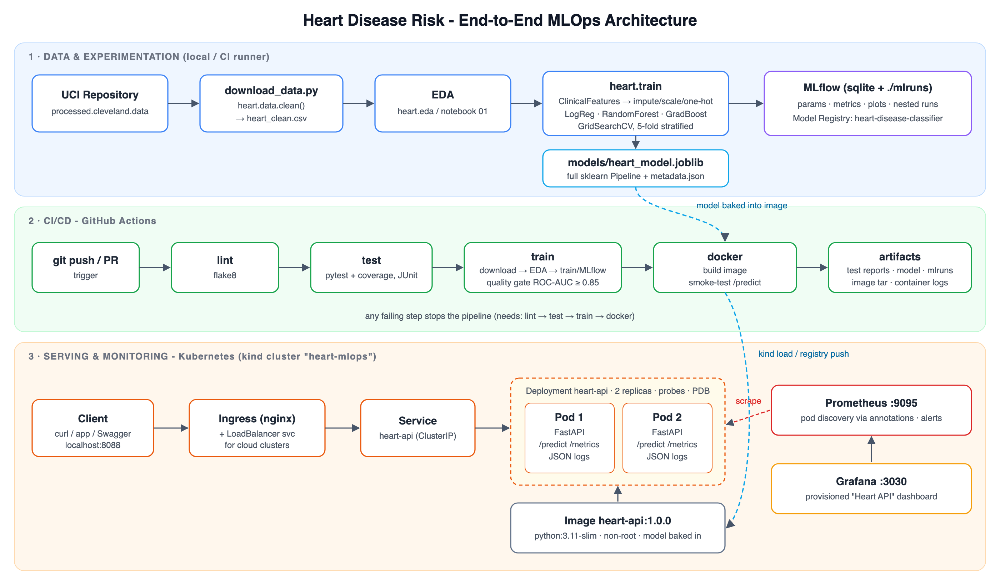

# Heart Disease Risk: an End-to-End MLOps Pipeline

BITS Pilani · Machine Learning Operations (AIMLCZG523) · Assignment 01

**Student:** Jayaprakash · **BITS ID:** 2025AE05611

This project predicts the risk of heart disease from 13 patient measurements in the UCI Heart Disease (Cleveland) dataset. It covers the full lifecycle:

- download and cleaning of the data
- EDA
- feature engineering
- tuning of three model families, tracked in MLflow
- a reproducible sklearn pipeline
- a FastAPI service in Docker
- a GitHub Actions CI/CD pipeline
- Kubernetes deployment with Ingress
- Prometheus and Grafana monitoring

| | |
|---|---|
| **Final model** | Logistic Regression (L2, C=0.5, class_weight=balanced) |
| **5-fold CV ROC-AUC** | 0.908 ± 0.020 |
| **Hold-out test** | ROC-AUC 0.959 · accuracy 0.869 · recall 0.929 · precision 0.813 |
| **Report** | [`reports/MLOps_Assignment1_Report.pdf`](reports/MLOps_Assignment1_Report.pdf) / [`.docx`](reports/MLOps_Assignment1_Report.docx) |
| **Code repository** | https://github.com/jpailabs/heart-disease-mlops |
| **CI status** | [](https://github.com/jpailabs/heart-disease-mlops/actions/workflows/ci.yml) |



---

## Repository layout

```
├── src/heart/            Python package
│   ├── config.py         paths, schema, feature groups
│   ├── data.py           download + cleaning
│   ├── eda.py            EDA figures
│   ├── features.py       ClinicalFeatures transformer + preprocessing pipeline
│   ├── train.py          GridSearchCV tuning, evaluation, MLflow logging, model selection
│   └── predict.py        inference helpers (shared by API, notebooks, CLI)
├── api/app.py            FastAPI service (/predict, /predict/batch, /health, /ready, /model-info, /metrics)
├── notebooks/            01_eda · 02_model_training · 03_inference (executed, with outputs)
├── tests/                pytest unit tests (data, features, model, API)
├── data/raw | processed  raw UCI file + cleaned CSV
├── models/               heart_model.joblib (full pipeline) + model_metadata.json
├── mlflow.db, mlruns/    MLflow tracking store + artifacts
├── .github/workflows/    ci.yml - lint → test → train → docker
├── Dockerfile            multi-stage, non-root serving image
├── docker-compose.yml    API + Prometheus + Grafana (local)
├── k8s/                  kind cluster, Deployment, Services (ClusterIP + LoadBalancer), Ingress, PDB
│   └── monitoring/       Prometheus (pod discovery, alerts) + Grafana (provisioned dashboard)
├── monitoring/           Prometheus / Grafana configs and dashboard JSON
├── scripts/              download_data · deploy_kind · smoke_test · ci_local
├── screenshots/          evidence for the report
└── reports/              final report (md / docx / pdf), figures, architecture diagram
```

## 1. Setup from a clean machine

Requirements: Python 3.11, Docker. For Kubernetes you also need `kubectl` and `kind`.

```bash
python3.11 -m venv .venv
source .venv/bin/activate
pip install -r requirements.txt
pip install -e .
```

`requirements.txt` pins the direct dependencies. `requirements-lock.txt` is the full `pip freeze` for exact reproduction. `requirements-serve.txt` is the slim runtime set used by the Docker image.

## 2. Data → EDA → training

```bash
python scripts/download_data.py          # downloads from UCI, writes data/processed/heart_clean.csv
python -m heart.eda                      # figures -> reports/figures/
python -m heart.train --register         # tunes 3 models, logs to MLflow, saves models/heart_model.joblib
mlflow ui --backend-store-uri sqlite:///mlflow.db --port 5050   # browse experiments
```

Single prediction from the CLI:

```bash
python -m heart.predict "$(cat sample_request.json)"
```

## 3. Tests and lint

```bash
pytest --cov=src/heart --cov=api
flake8 src api tests scripts
./scripts/ci_local.sh                    # runs the same stages as GitHub Actions
```

## 4. Docker

```bash
docker build -t heart-api:1.0.0 .
docker run -d -p 8090:8000 --name heart-api heart-api:1.0.0
curl -X POST localhost:8090/predict -H 'content-type: application/json' -d @sample_request.json
```

Sample response:

```json
{"prediction":1,"label":"disease","probability_disease":0.8945,"confidence":0.8945,
 "risk_band":"high","model_name":"logistic_regression","model_version":"1.0.0"}
```

Swagger UI: `http://localhost:8090/docs`

Local monitoring stack (API on 8090, Prometheus on 9090, Grafana on 3000):

```bash
docker compose up -d --build
```

## 5. Kubernetes (local kind cluster)

```bash
./scripts/deploy_kind.sh                 # build, create cluster, load image, ingress-nginx, API, Prometheus, Grafana
./scripts/smoke_test.sh http://localhost:8088 100
```

| Endpoint | URL |
|---|---|
| API via Ingress | http://localhost:8088/docs |
| Prometheus | http://localhost:9095 |
| Grafana (anonymous viewer, admin/admin) | http://localhost:3030 |

On a cloud cluster (GKE/EKS/AKS):

1. Push the image to a registry.
2. Update `image:` in `k8s/deployment.yaml`.
3. Apply the same manifests. The `heart-api-lb` Service gets an external IP.

To clean up:

```bash
kind delete cluster --name heart-mlops
```

## 6. CI/CD

`.github/workflows/ci.yml` runs on every push and pull request. Each job depends on the previous one, so any lint error, failing test or missed quality gate stops the pipeline:

1. **lint**: flake8.
2. **test**: pytest with JUnit and coverage reports, uploaded as an artifact.
3. **train**: download → EDA → tune/track → quality gate (test ROC-AUC ≥ 0.85). Uploads the model, MLflow store, figures and training log.
4. **docker**: builds the image, starts it, calls `/predict` as a smoke test, and uploads the image tarball and container logs.

## API reference

| Method | Path | Purpose |
|---|---|---|
| POST | `/predict` | one patient JSON → `prediction`, `probability_disease`, `confidence`, `risk_band` |
| POST | `/predict/batch` | `{"patients": [...]}` (up to 500 records) |
| GET | `/health`, `/ready` | liveness / readiness (model loaded) |
| GET | `/model-info` | model name, params, metrics, MLflow run id |
| GET | `/metrics` | Prometheus metrics |

Input fields follow the UCI data dictionary: `age, sex, cp, trestbps, chol, fbs, restecg, thalach, exang, oldpeak, slope, ca, thal`. `ca` and `thal` are optional, and the pipeline imputes them when missing. Out-of-range values are rejected with HTTP 422.
