**Code repository:** <https://github.com/jpailabs/heart-disease-mlops> (private; grant access to the evaluator)
**Live API & web UI:** <https://heart.jpailabs.tech> (Railway) · local Kubernetes access in §10

# 1. Executive summary

This project builds a classifier that predicts whether a patient has heart disease from 13 routine clinical measurements, using the UCI Heart Disease (Cleveland) dataset. The model is served as a monitored REST API on Kubernetes. Every stage is automated and reproducible:

| Stage | Implementation |
|---|---|
| Data acquisition | `scripts/download_data.py` downloads the file from UCI; `heart.data.clean()` cleans it |
| EDA | `heart.eda` and notebook `01_eda.ipynb` (7 figures) |
| Features | custom `ClinicalFeatures` transformer, plus imputation, scaling and one-hot encoding in one sklearn `Pipeline` |
| Models | Logistic Regression, Random Forest and Gradient Boosting, each tuned with `GridSearchCV` (5-fold stratified CV) |
| Tracking | MLflow (SQLite backend): 80 runs (parent + nested grid points), plots, a model registry |
| Packaging | `heart_model.joblib` (full pipeline), an MLflow model with signature, pinned and locked requirements |
| CI/CD | GitHub Actions: lint → test → train with quality gate → Docker build and smoke test, with artifacts at each stage |
| Serving | FastAPI with input validation; `/predict` returns a prediction plus a confidence score |
| Deployment | kind Kubernetes cluster: 2 replicas, probes, PDB, Ingress (nginx) and a LoadBalancer service; public cloud deployment on Railway at https://heart.jpailabs.tech, with a web UI |
| Monitoring | structured JSON request logs; Prometheus (per-pod scraping, alert rules); a provisioned Grafana dashboard |

**Result.** Tuned Logistic Regression was selected. Its mean 5-fold CV ROC-AUC is **0.908**. On the hold-out test set it scores ROC-AUC **0.959**, accuracy **0.869** and recall **0.929**.

# 2. Architecture

{width=100%}

There are three layers:

1. **Data & experimentation.** These steps run locally or on the CI runner. They produce the cleaned dataset, the EDA figures, MLflow runs and the model artefact.
2. **CI/CD.** The GitHub Actions pipeline repeats the experimentation steps from scratch on every push. It gates on model quality, then builds and tests the container.
3. **Serving & monitoring.** The image runs on Kubernetes behind an Ingress. Prometheus scrapes every pod and Grafana shows service and model metrics.

**Design decisions**

* **One pipeline object.** Feature engineering, imputation, scaling and encoding all live inside a single sklearn `Pipeline`. Training, notebooks and the API therefore run identical preprocessing code, which rules out training/serving skew.
* **Model baked into the image.** The image is immutable and versioned (`heart-api:1.0.0`). A rollout or rollback is just an image tag change. The MLflow registry keeps the full lineage (run id → image metadata via `/model-info`).
* **Per-pod scraping.** Prometheus uses Kubernetes pod discovery driven by `prometheus.io/*` annotations, not the Service. Scraping through the Service would land on a random replica each time and give inconsistent counters.

# 3. Setup and installation

```bash
python3.11 -m venv .venv && source .venv/bin/activate
pip install -r requirements.txt && pip install -e .
python scripts/download_data.py      # data
python -m heart.eda                  # EDA figures
python -m heart.train --register     # tuning + MLflow + model artefact
pytest && flake8 src api tests scripts
./scripts/deploy_kind.sh             # Docker build + kind + Ingress + monitoring
./scripts/smoke_test.sh http://localhost:8088 100
```

There are three requirement files:

* `requirements.txt` pins direct dependencies.
* `requirements-lock.txt` is a full `pip freeze` (168 packages) for exact rebuilds.
* `requirements-serve.txt` contains the 8 runtime packages used in the slim serving image.

The whole sequence was run from a fresh virtual environment. Running the pipeline again (`scripts/ci_local.sh`) gave identical metrics, because every random seed is fixed to 42.

# 4. Data acquisition and EDA

**Source.** `processed.cleveland.data` from the UCI Machine Learning Repository: 303 patients, 13 features and the `num` diagnosis (0-4). The file has no header row, and missing values are written as `?`.

**Cleaning (`heart.data.clean`)**

* Every column is coerced to numeric. `?` becomes NaN.
* Exact duplicate rows are dropped (there are none in Cleveland).
* Codes outside the documented ranges (e.g. `cp ∉ {1..4}`, `thal ∉ {3,6,7}`) and impossible values (`chol ≤ 0`, `trestbps ≤ 0`) are set to NaN. This protects the pipeline against corrupted inputs; the unit tests cover it.
* The target is binarised: `target = 1 if num > 0`. Classes 1-4 all mean that disease is present.
* Missing values (`ca`: 4, `thal`: 2) are **not** imputed at this stage. They are imputed inside the model pipeline (median for numeric, mode for categorical), fitted on the training fold only, so the CV estimates contain no leakage.

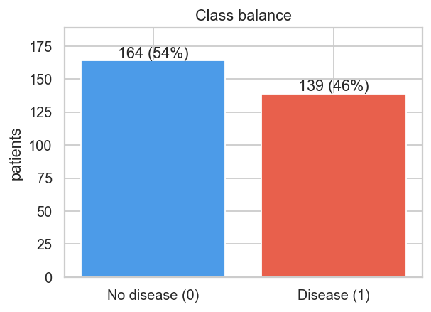{width=40%} 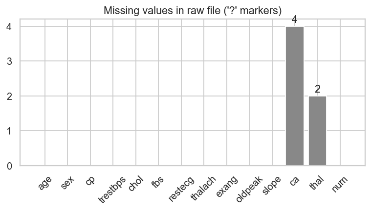{width=52%}

The classes are mildly imbalanced: 54 % no disease and 46 % disease. Stratified splits are used everywhere, and `class_weight` is part of the tuning grid.

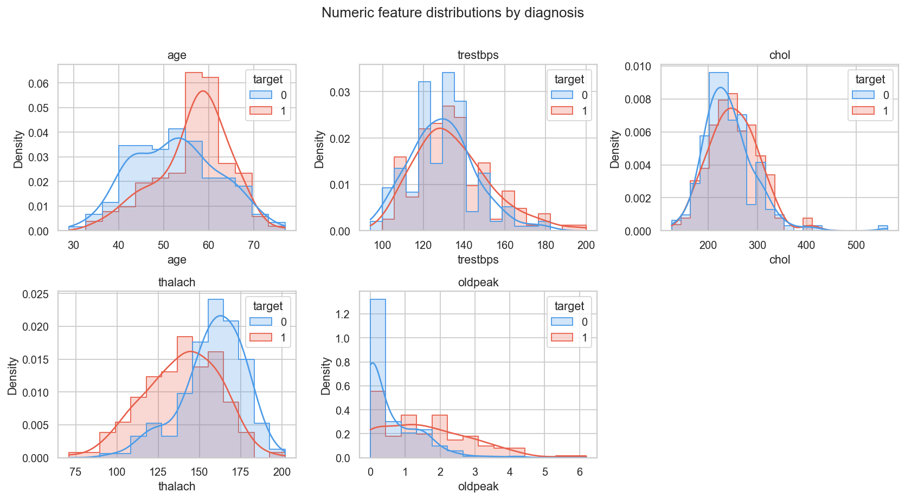{width=82%}

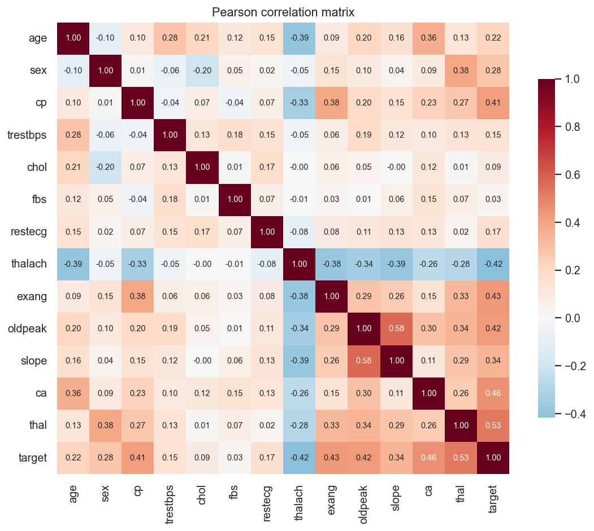{width=58%}

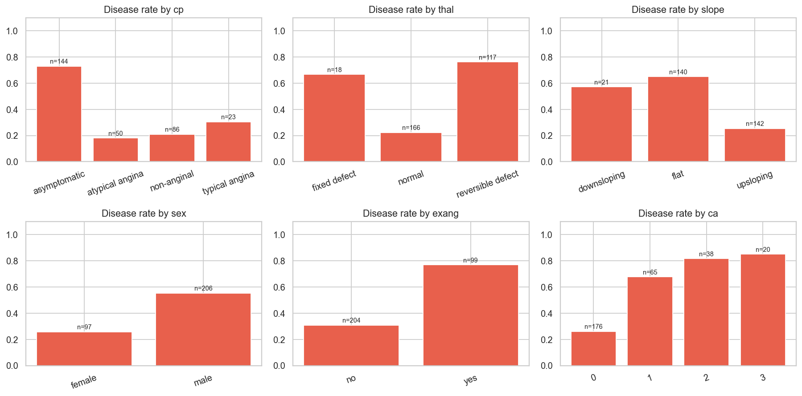{width=82%}

**Key findings**

* The strongest correlations with the target are `thal` (0.53), `ca` (0.46), `exang` (0.43), `oldpeak` (0.43), `thalach` (−0.42) and `cp` (0.41).
* Patients with disease reach a **lower peak heart rate** and show **more exercise-induced ST depression**. `chol` and `trestbps` separate the classes only weakly.
* Asymptomatic chest pain (`cp = 4`) and a reversible thallium defect (`thal = 7`) have disease rates above 70 %. These are nominal codes, so they are **one-hot encoded**, not treated as ordinal numbers.
* The box plots show a few high cholesterol values (up to 564 mg/dl). They are clinically plausible, so they are kept, and standard scaling limits their influence on the linear model.

# 5. Feature engineering and model development

**Feature pipeline (`heart.features`)**

| Group | Columns | Transform |
|---|---|---|
| Engineered | `hr_reserve_pct = thalach / (220 − age)`, `chol_age_ratio = chol / age` | computed by the `ClinicalFeatures` transformer |
| Numeric | age, trestbps, chol, thalach, oldpeak, ca, plus the 2 engineered columns | median impute → `StandardScaler` |
| Binary | sex, fbs, exang | mode impute |
| Nominal | cp, restecg, slope, thal | mode impute → `OneHotEncoder(handle_unknown="ignore")` |

This gives 24 model features. `hr_reserve_pct` encodes *chronotropic incompetence*: failing to reach about 85 % of the age-predicted maximum heart rate is a recognised cardiac risk marker. Raw `thalach` mixes that effect with age.

**Protocol**

* 80/20 stratified train/test split (242 / 61 patients). The test set is used **only** for the final report.
* Each model family is tuned with `GridSearchCV` (scoring = ROC-AUC, `StratifiedKFold(5, shuffle, seed 42)`).
* The tuned estimator is then re-scored with `cross_validate` on accuracy, precision, recall, F1 and ROC-AUC.
* Selection rule: highest mean CV ROC-AUC, with ties broken by CV recall. A missed disease case (false negative) costs more than a false alarm.

**Search spaces**

| Model | Grid | Points |
|---|---|---|
| Logistic Regression | C ∈ {0.01, 0.05, 0.1, 0.5, 1, 5}; penalty ∈ {l1, l2}; class_weight ∈ {None, balanced} | 24 |
| Random Forest | n_estimators ∈ {200, 400}; max_depth ∈ {3, 5, None}; min_samples_leaf ∈ {1, 3, 5}; max_features ∈ {sqrt, 0.5} | 36 |
| Gradient Boosting | n_estimators ∈ {100, 200}; learning_rate ∈ {0.03, 0.1}; max_depth ∈ {2, 3}; subsample ∈ {0.8, 1.0} | 16 |

The grids are kept small on purpose. With about 240 training rows, wide grids mostly overfit the CV folds.

**Baseline (default hyper-parameters, 5-fold CV ROC-AUC):** LogReg 0.906 · RF 0.876 · GB 0.859.

**Tuned results**

| Model | Best params | CV acc | CV prec | CV recall | CV F1 | **CV ROC-AUC** | Test acc | Test recall | Test ROC-AUC |
|---|---|---|---|---|---|---|---|---|---|
| **Logistic Regression** | C=0.5, L2, balanced | **0.847** | **0.866** | **0.801** | **0.827** | **0.908 ± 0.020** | 0.869 | **0.929** | **0.959** |
| Random Forest | 200 trees, depth 3, sqrt | 0.810 | 0.833 | 0.747 | 0.781 | 0.896 | 0.885 | 0.893 | 0.951 |
| Gradient Boosting | 100 trees, lr 0.03, depth 2, subsample 0.8 | 0.814 | 0.827 | 0.765 | 0.789 | 0.884 | 0.902 | 0.929 | 0.957 |

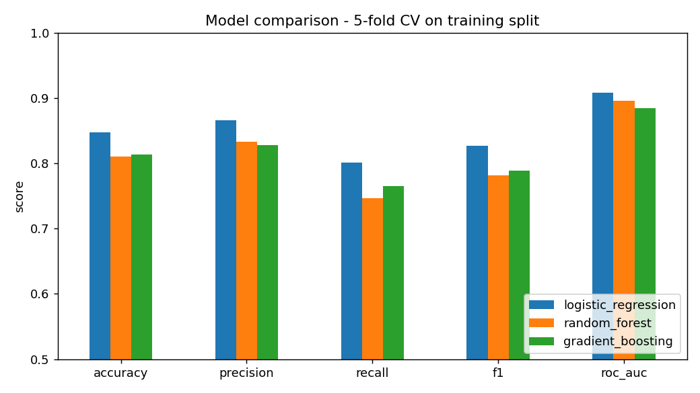{width=62%}

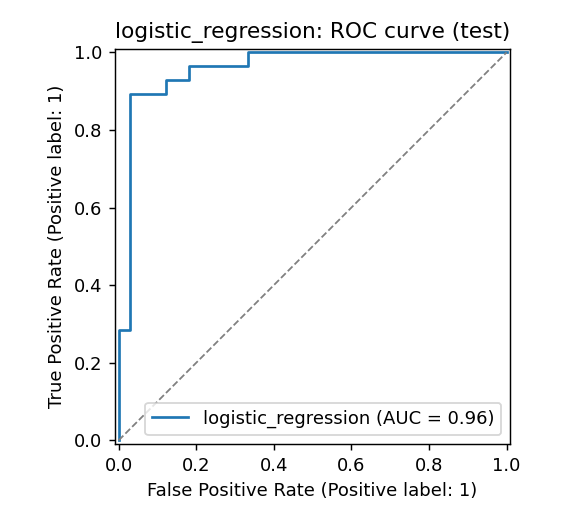{width=30%} 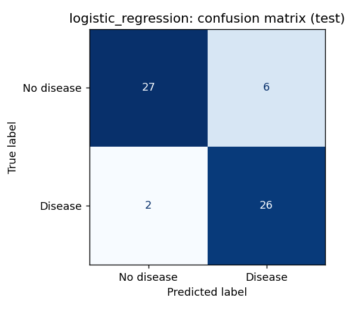{width=30%} 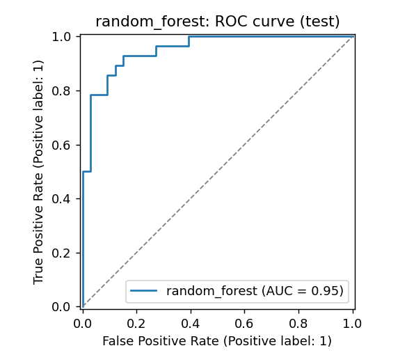{width=30%}

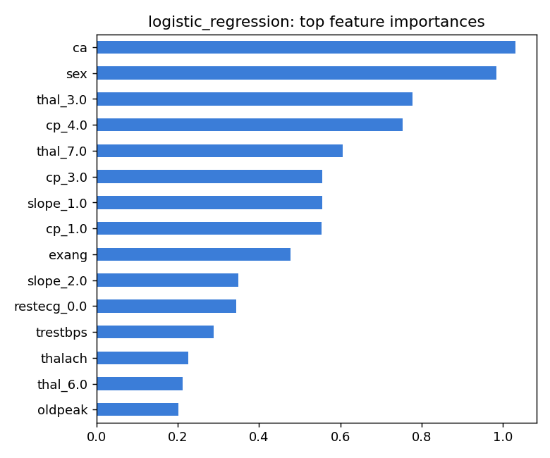{width=48%}

**Why Logistic Regression.** It has the best mean CV ROC-AUC, the best CV recall and the lowest variance across folds. Tuning helped the tree ensembles most (RF went from 0.876 to 0.896), but they still trail the linear model. That is expected for a small dataset whose signal is mostly additive. Gradient Boosting has a slightly higher *test* accuracy (0.902 vs 0.869), but on 61 patients that gap is 2 patients. Choosing a model on the test set would make the test estimate optimistic. Logistic Regression also has interpretable coefficients, which matters for clinical use. The largest coefficients are `ca`, `thal=7`, `cp=4`, `sex` and `oldpeak`, which matches the EDA.

# 6. Experiment tracking (MLflow)

`heart.train` logs to the `heart-disease-uci` experiment (`sqlite:///mlflow.db`, artifacts under `./mlruns`). The experiment holds 80 runs in total.

* **One parent run per model family.** Each logs:
  * tags: `model_family`, `stage`, `code_version`
  * best parameters and grid size
  * 10 CV metrics (mean and std) and 5 test metrics
  * plots: confusion matrix, ROC curve, feature importance
  * the full `cv_results_` table as CSV
  * the fitted pipeline as an MLflow model, with a float signature and an input example
* **One nested child run per grid point** (76 in total), each with its parameters, CV ROC-AUC mean/std and train ROC-AUC. Comparing train and validation scores per grid point shows overfitting directly, e.g. Random Forest with `max_depth=None` averages train AUC 0.99 but CV AUC 0.885, while depth 3 gives 0.95 / 0.891.
* **A `model_selection` run** records the winner, its run id, the comparison plot and the comparison table.
* **Model registry.** The winning run is registered as `heart-disease-classifier` v1.

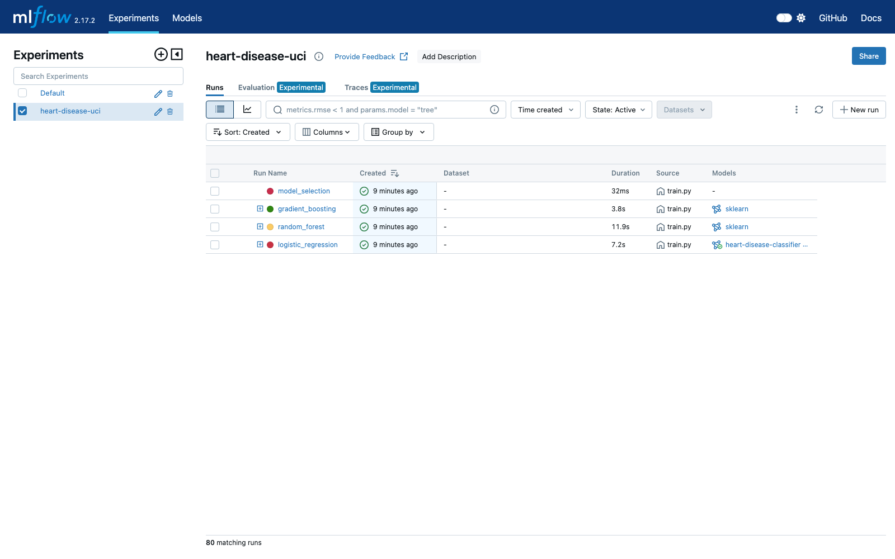{width=78%}

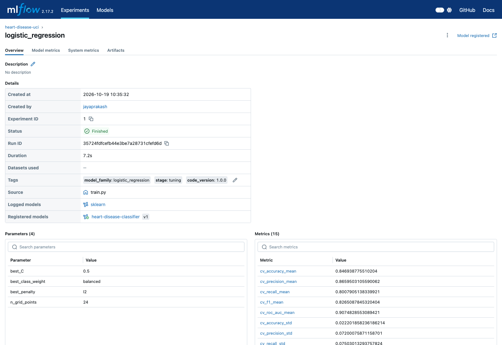{width=78%}

# 7. Packaging, reproducibility and testing

* **Artefacts.**
  * `models/heart_model.joblib`: the entire pipeline, raw JSON fields → probability.
  * `models/model_metadata.json`: params, metrics, feature list, MLflow run id and training timestamp.
  * The MLflow `model/` directory: MLmodel, conda/pip env and signature.
* **Reproducibility.** Seeds are fixed. Data download and cleaning are scripted. Dependencies are pinned and locked. Missing values are imputed inside the pipeline. Unseen categories are ignored by the one-hot encoder.
* **Unit tests (22, pytest).** They use a synthetic fixture, so they need no network and run in about 10 seconds.
  * `test_data.py`: target binarisation, `?` parsing, out-of-range codes, duplicates.
  * `test_features.py`: engineered feature values, NaN-free and scaled output, unseen categories, pipeline `predict_proba`.
  * `test_model.py`: metric helpers, feature importance, MLflow logging of a candidate, joblib round-trip, missing optional fields, risk bands.
  * `test_api.py`: health/ready, `/predict` contract, 422 validation, batch, `/metrics`.

  Coverage is 97 % for the API, and 64 % overall: `eda.py` is plotting code and is run by CI instead of unit-tested.

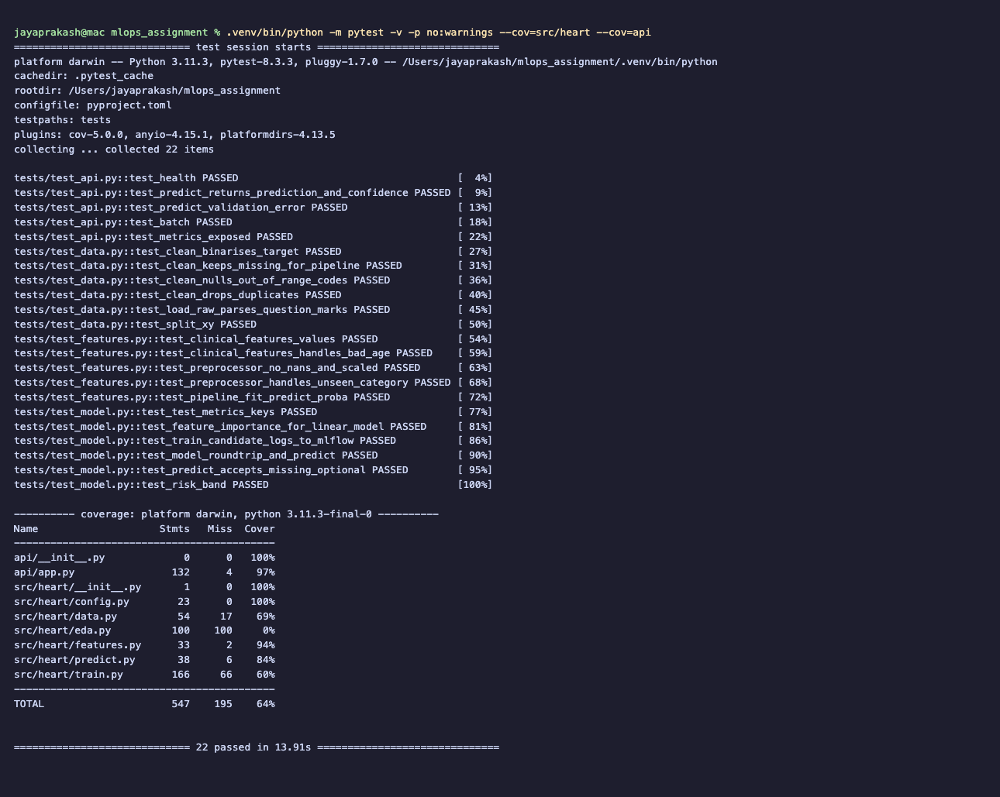{width=62%}

# 8. CI/CD pipeline (GitHub Actions)

`.github/workflows/ci.yml` runs on push to `main`, on pull requests and on manual dispatch. The jobs are chained with `needs:`, so any failure stops the pipeline and its log shows the failing step.

| Job | Steps | Artifacts |
|---|---|---|
| `lint` | flake8 with `--show-source --statistics` | job log |
| `test` | install → pytest with JUnit XML and coverage XML | `test-reports/` |
| `train` | download → EDA → `heart.train --register` → **quality gate: test ROC-AUC ≥ 0.85** | model, `mlflow.db`, `mlruns/`, figures, `train.log` |
| `docker` | download model artifact → `docker build` → run container → poll `/ready` → POST `/predict` and assert the response | image tarball, `container.log`, `prediction.json` |

The same stages can be run locally with `scripts/ci_local.sh`. It trains into a temporary MLflow store so the main experiment stays untouched:

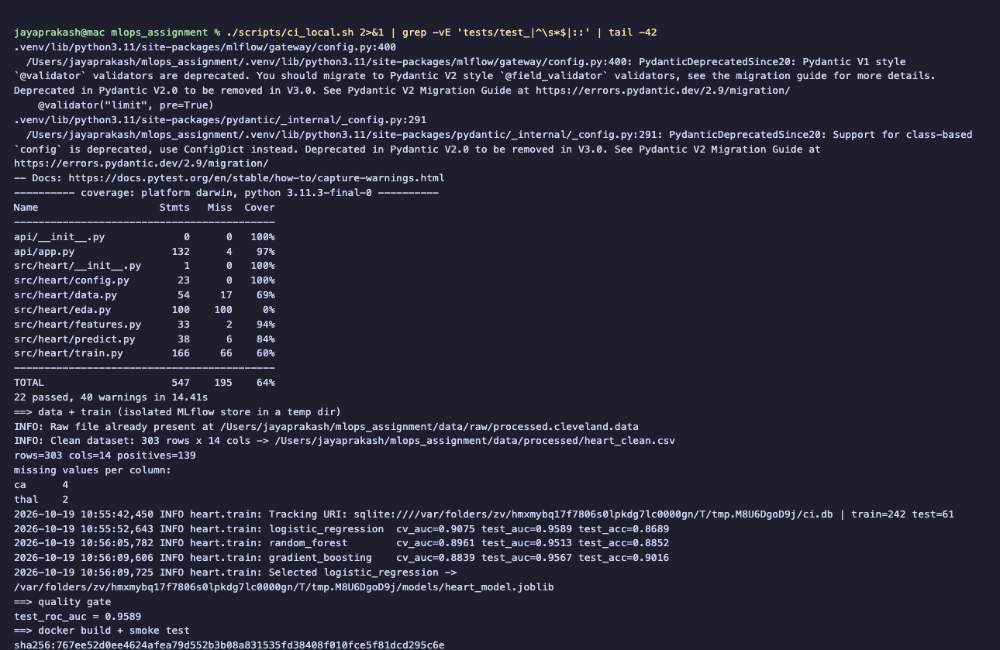{width=72%}

**GitHub Actions run** ([run 39194105001](https://github.com/jpailabs/heart-disease-mlops/actions/runs/39194105001)): all four jobs passed on a clean Ubuntu runner. CI training reproduced exactly the local test metrics (ROC-AUC 0.9589), which confirms the pipeline is reproducible across machines.

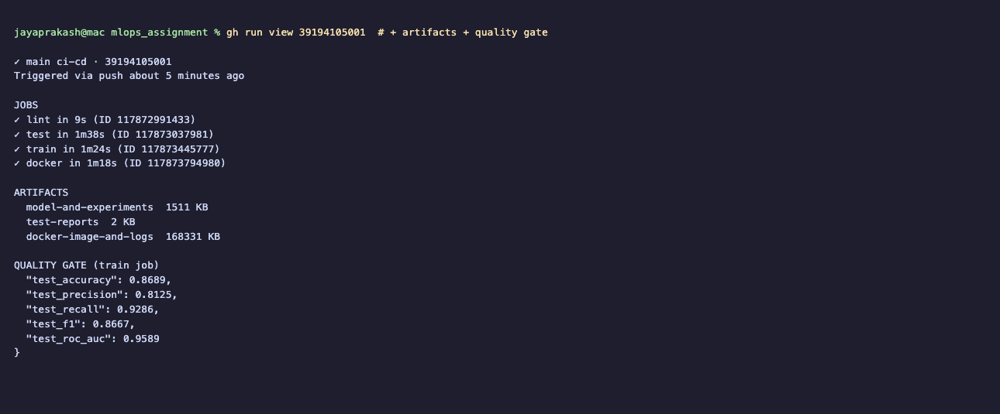{width=70%}

# 9. Containerisation and the serving API

The **Dockerfile** is multi-stage:

* A builder stage creates a virtualenv with only `requirements-serve.txt`.
* The runtime stage is `python:3.11-slim`. It runs as non-root UID 10001, has a `HEALTHCHECK`, and includes only `src/`, `api/` and the model.
* Uvicorn runs a single worker per container, so Prometheus counters are not split across processes. Scaling comes from Kubernetes replicas instead.

**API (`api/app.py`, FastAPI)**

* **Input validation.** A Pydantic schema enforces field ranges and allowed codes, so an invalid record gets HTTP 422. `ca` and `thal` are optional and imputed when missing.
* **`/predict` response.** It returns:
  * `prediction` (0/1) and `label`
  * `probability_disease`
  * `confidence`: the probability of the predicted class
  * `risk_band`: low below 0.3, moderate from 0.3 to 0.6, high above 0.6
  * the model name and version
* **Other endpoints:** `/predict/batch` (up to 500 records), `/health`, `/ready`, `/model-info` and `/metrics`.
* **Settings** come from environment variables: `MODEL_PATH`, `DECISION_THRESHOLD` and `LOG_LEVEL`.

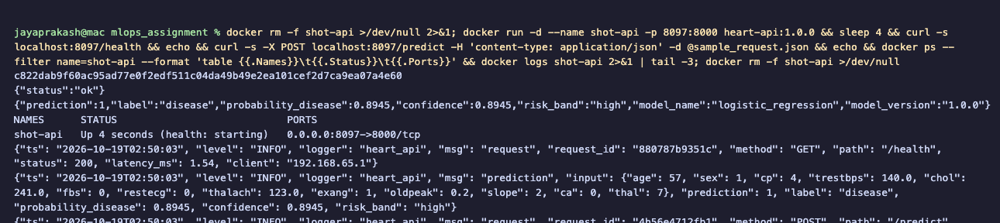{width=85%}

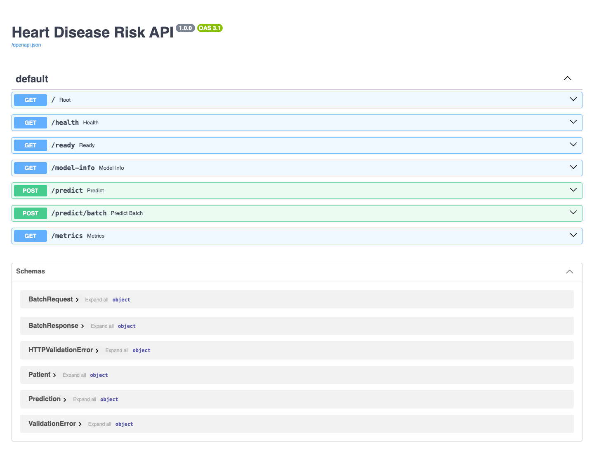{width=60%}

# 10. Production deployment (Kubernetes)

The target is a local **kind** cluster (`k8s/kind-cluster.yaml`). The same manifests work on GKE, EKS or AKS by changing the image reference.

* `deployment.yaml`:
  * 2 replicas, RollingUpdate (`maxUnavailable: 0`)
  * readiness probe on `/ready`, liveness probe on `/health`
  * CPU and memory requests and limits
  * non-root user, read-only root filesystem, all Linux capabilities dropped
  * `prometheus.io/*` annotations so Prometheus discovers the pods
* `service.yaml`: a ClusterIP Service for the Ingress, plus a **LoadBalancer** Service (`heart-api-lb`) that gets an external IP on cloud providers or Docker Desktop.
* `ingress.yaml`: ingress-nginx routes `localhost:8088/` to the API.
* `configmap.yaml` holds the runtime settings. `pdb.yaml` keeps at least one pod available during voluntary disruptions.
* `scripts/deploy_kind.sh` automates the whole sequence: build → create cluster → `kind load` → ingress-nginx → apply manifests → wait for rollouts.

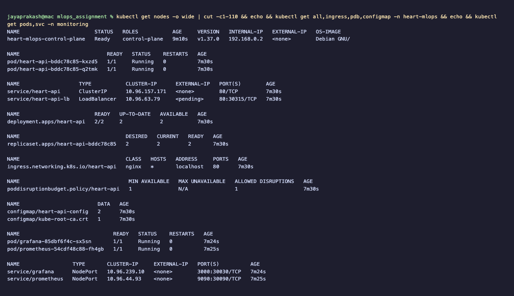{width=72%}

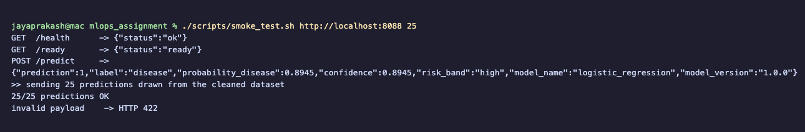{width=80%}

**Access instructions (local testing):** run `./scripts/deploy_kind.sh`, then:

```bash
curl -X POST http://localhost:8088/predict -H 'content-type: application/json' -d @sample_request.json
```

Interactive documentation is at `http://localhost:8088/docs`.

## 10.1 Public cloud deployment: Railway

Kubernetes is the main deployment target. The same model and API, packaged with an added web UI, also run on **Railway**, which provides a public, HTTPS-secured endpoint at **<https://heart.jpailabs.tech>**.

* **Repository.** The deployment repo, [jpailabs/heart-disease-railway](https://github.com/jpailabs/heart-disease-railway), contains the serving code, the trained pipeline and a Railway configuration file (`railway.json`). That file sets the Dockerfile builder, a `/ready` healthcheck and restart-on-failure. Railway builds the image and redeploys it on every push to `main`. Its CI also smoke-tests the container with a Railway-style `PORT` variable.
* **Port.** The Dockerfile listens on `${PORT:-8000}`, so one image works on Railway, Docker and Kubernetes.
* **Web UI.** The UI at `/` is a form for entering a new patient. Its sections are demographics, symptoms and vitals, ECG and exercise test, and optional imaging fields. It sends the input to `/predict`, then shows:
  * the probability of disease on a low / moderate / high risk meter
  * the predicted class and the model's confidence
  * the history of predictions made in the session

  The browser checks the inputs, and the API checks them again (HTTP 422 for invalid input).
* **Custom domain.** `heart.jpailabs.tech` is a CNAME record in Hostinger DNS pointing to Railway's edge, plus a TXT record that proves ownership of the domain. Railway issues the Let's Encrypt certificate automatically.

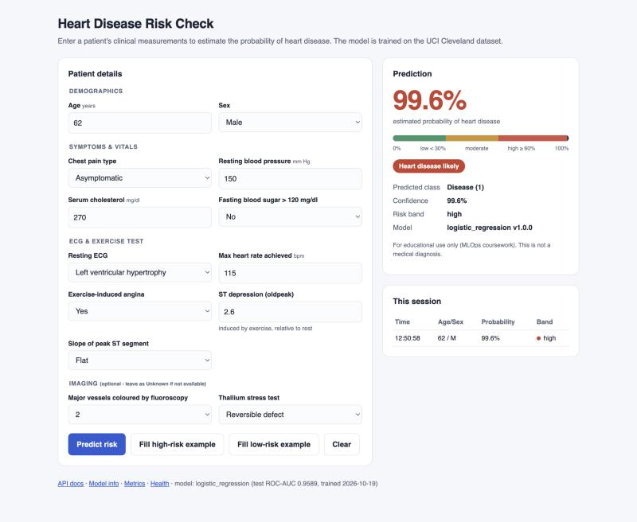{width=80%}

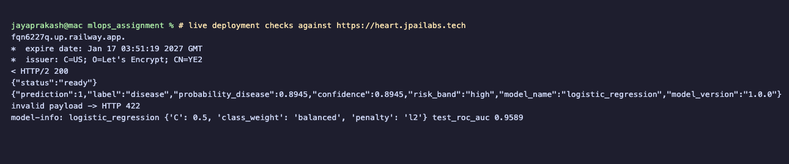{width=85%}

# 11. Monitoring and logging

* **Request logging.** HTTP middleware writes one JSON line per request to stdout, with `request_id`, method, path, status, latency and client IP. The request id is also returned in the `x-request-id` header. Each prediction is logged with its input and output, which gives an audit trail and data for later drift analysis. Kubernetes collects these logs with `kubectl logs`.
* **Metrics (`prometheus_client`):**
  * `heart_api_requests_total{method,path,status}`
  * `heart_api_request_latency_seconds` (histogram)
  * `heart_api_predictions_total{label,risk_band}`
  * `heart_api_predicted_probability` (histogram)
  * `heart_api_model_loaded`

  The probability histogram and the class mix are simple **model-behaviour monitors**. A sudden shift in the disease-positive share is an early warning of data drift.
* **Prometheus** discovers each pod and scrapes it every 5 seconds. It has three alert rules: API down, 5xx rate above 5 %, and p95 latency above 500 ms.
* **Grafana** is provisioned as code, with the datasource and dashboard JSON in ConfigMaps. The dashboard shows:
  * request totals
  * predictions served
  * disease-positive share
  * pods with the model loaded
  * request rate per endpoint
  * p50/p95 latency
  * predictions per risk band
  * HTTP status codes
  * the distribution of predicted probabilities

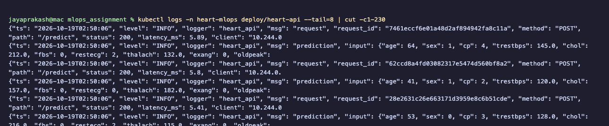{width=90%}

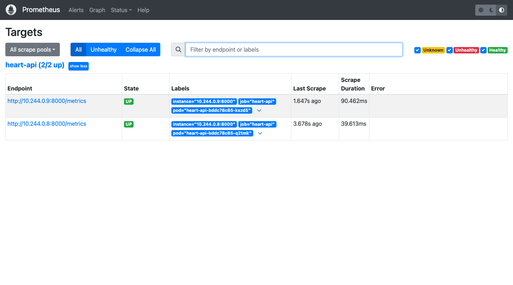{width=68%}

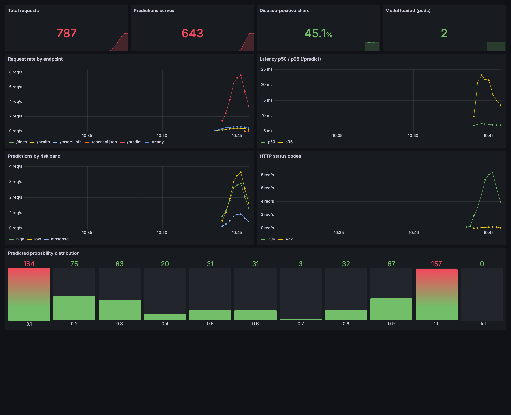{width=80%}

# 12. Limitations and next steps

* The dataset is small (303 patients) and comes from a single site, so the test metrics have wide confidence intervals: ±0.08 accuracy at 61 samples. External validation on the Hungarian, Swiss and VA subsets would be the next step.
* Probability calibration (isotonic or Platt) and threshold tuning for a recall target would make `confidence` more meaningful clinically.
* The model is baked into the image. A registry-driven loader that pulls the `Production` alias from MLflow would decouple model releases from image releases.
* Add a CD stage that pushes to a container registry and deploys to a cloud cluster, with canary releases and automatic rollback on the Prometheus alerts.

# Appendix A: Deliverables checklist

| Deliverable | Location |
|---|---|
| Code, Dockerfile, requirements | `src/`, `api/`, `Dockerfile`, `requirements*.txt` |
| Cleaned dataset + download script | `data/processed/heart_clean.csv`, `scripts/download_data.py` |
| Notebooks (EDA, training, inference) | `notebooks/01_eda.ipynb`, `02_model_training.ipynb`, `03_inference.ipynb` |
| Unit tests | `tests/` |
| CI workflow | `.github/workflows/ci.yml` |
| Deployment manifests | `k8s/`, `k8s/monitoring/` |
| Screenshots | `screenshots/` (23 images) |
| Report | `reports/MLOps_Assignment1_Report.pdf` / `.docx` |
| API access | live: https://heart.jpailabs.tech (web UI, `/docs`); local Kubernetes: §10 |
